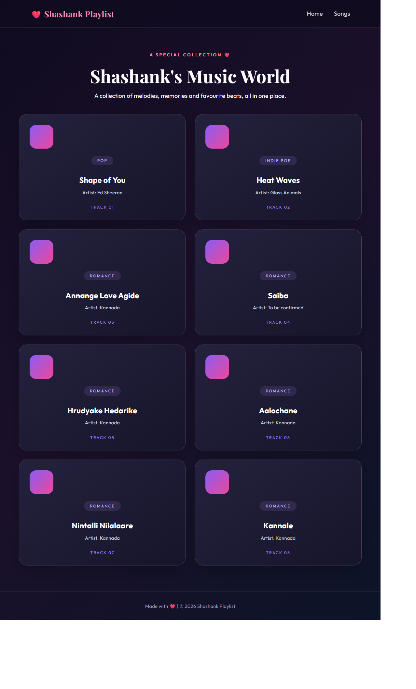

# Shashank Playlist ❤️

### His Vibe. His Music. His Playlist.

Shashank Playlist is a personalized music playlist web application built using **Node.js, Express.js, and EJS**. It presents a curated collection of songs through a modern interface, bringing together music, memories, and meaningful moments in one place.

---

## ✨ Features

- **Personalized Homepage** – A dedicated welcome page with a unique presentation.
- **Curated Song Collection** – A collection of selected songs displayed in an organized card layout.
- **Letter-Based Song Cards** – Each song features an individual letter, creating a distinctive presentation.
- **Dynamic Rendering** – Song information is rendered dynamically using EJS.
- **Modern Card Design** – Custom-styled song cards with interactive hover effects.
- **Responsive Design** – A clean interface designed for different screen sizes.
- **Simple Navigation** – Easy navigation between the homepage and song collection.

---

## 🖥️ Screenshots

### Homepage


### Playlist Collection



---

## 🛠️ Tech Stack

| Technology | Purpose |
|---|---|
| Node.js | JavaScript runtime environment |
| Express.js | Backend web framework |
| EJS | Dynamic HTML templating |
| HTML5 | Webpage structure |
| CSS3 | Styling and responsive interface |
| Git & GitHub | Version control and project hosting |

---

## 📁 Project Structure

```text
Shashank-Playlist/
│
├── public/
│   ├── screenshots/
│   │   ├── home page.png
│   │   └── playlist.png
│   └── style.css
│
├── views/
│   ├── index.ejs
│   └── songs.ejs
│
├── app.js
├── package.json
├── package-lock.json
├── .gitignore
└── README.md
```

---

## ⚙️ Installation & Setup

Follow these steps to run the project locally.

**1. Clone the repository**

```bash
git clone https://github.com/Shashank74831/Shashank-Playlist.git
```

**2. Navigate to the project directory**

```bash
cd Shashank-Playlist
```

**3. Install dependencies**

```bash
npm install
```

**4. Start the application**

```bash
node app.js
```

**5. Open in your browser**

```text
http://localhost:3000
```

To explore the song collection directly:

```text
http://localhost:3000/songs
```

---

## 🌐 Application Routes

| Route | Description |
|---|---|
| `/` | Displays the homepage |
| `/songs` | Displays the curated song collection |

---

## 🎯 Project Objective

The objective of Shashank Playlist is to combine web development with personalization, transforming a simple song collection into an engaging digital music experience.

This project demonstrates the use of server-side rendering, Express routing, dynamic content management, custom CSS styling, and structured project organization.

---

## 🚀 Future Enhancements

- Integrated music playback.
- Search and filter functionality.
- User-created playlists.
- Database integration.
- User authentication and personalized collections.

---

## 👨‍💻 Developer

**Shashank**

GitHub: [@Shashank74831](https://github.com/Shashank74831)

---

<p align="center">
  Made with ❤️ and music.
</p>
